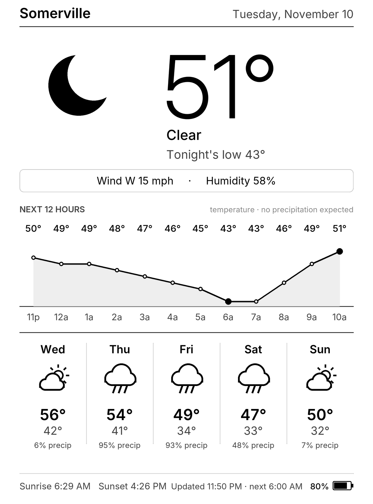

# Kindle Weather Display

A Home Assistant add-on that renders a weather forecast as a 1072×1448, 16-level
grayscale PNG for a jailbroken Kindle Paperwhite (7th gen) used as an e-ink weather display.

- Forecast and current conditions from the US [National Weather Service API](https://www.weather.gov/documentation/services-web-api) (US locations only, no API key)
- Optional Home Assistant sensor for the headline temperature, with fallback to NWS
- Next-12-hours chart: precipitation chance, or a temperature curve when no precipitation is forecast
- 5-day forecast, sunrise/sunset, battery level reported by the Kindle
- `/sleep` endpoint tells the Kindle how long to deep-sleep, honouring a quiet window overnight

## Install

1. In Home Assistant: **Settings → Add-ons (Apps) → Store → ⋮ → Repositories**, add
   `https://github.com/danzilio/kindle-weather-display`
2. Install **Kindle Weather**, set your options, and start it.
3. Browse to `http://<home-assistant>:8099/` to preview the image.

See [kindle_weather/DOCS.md](kindle_weather/DOCS.md) for endpoints and options.

## The Kindle side

The Kindle fetches `/weather.png?battery=NN&charging=0|1`, draws it with `eips`, asks
`/sleep` for the number of seconds until the next refresh, then suspends to RAM with an RTC
wake alarm. The device script isn't published in this repository yet.
